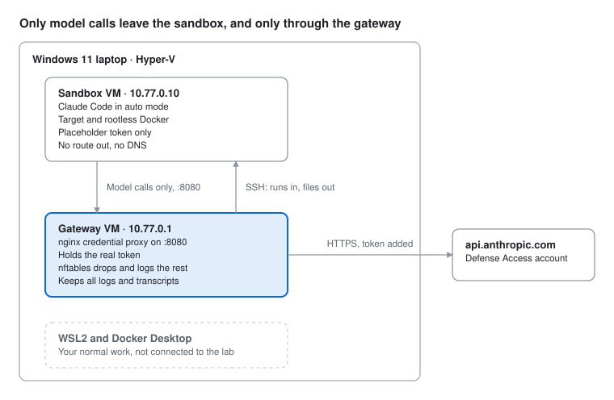

# agent-sandbox

A contained lab for running Claude Code on defensive security work, built to
Anthropic's [agent containment best practices](docs/sources.md) for Cyber
Verification Program participants, on a Windows 11 laptop with Hyper-V.

A sandbox VM runs the agent and the target with no route out. A gateway VM holds
the Claude token, forwards model calls and nothing else, and keeps every log.
[docs/design.md](docs/design.md) explains why each control exists and where the
build falls short of the guidance.



The two Ubuntu installs are manual (about 10 minutes each). Everything else is
scripted, including the isolation checks and a one-command run. Needs Windows 11
Pro, Enterprise or Education.

## What's here

| File | Runs on | Does |
| --- | --- | --- |
| `windows/agentlab.ps1` | Windows, admin PowerShell | Builds the switch and VMs; cutover, baseline, revert, run, stop, check |
| `linux/gateway-setup.sh` | Gateway VM | Network, firewall, credential proxy, logging, token, run key |
| `linux/sandbox-setup.sh` | Sandbox VM | `install`, `cutover`, `finalize` and `reopen` phases |
| `linux/agentlab-check.sh` | Both VMs | Isolation checks (`gateway` or `sandbox`) |
| `linux/agentlab-run` | Gateway | Launches one run: preflight, limits, transcript, evidence, scan |
| `linux/agentlab-monitor.py` | Gateway | Live view; stops runs not in auto mode or over the denial budget |
| `linux/agentlab-scan.py` | Gateway | Pattern rules over transcripts |
| `templates/` | — | Task template and the escape test |
| `tests/` | Linux or CI | Firewall, proxy, launcher and transcript-tool tests (see Testing) |
| `docs/` | — | Design rationale, layout diagram, sources |
| `.claude/agents/` | Claude Code sessions | Review agents from the agency-agents catalog, routed in `CLAUDE.md` |

Read the scripts before you run them. They are short, and they draw the boundary.

## Build it (once)

**0. Before you start**
- Hyper-V on: `Enable-WindowsOptionalFeature -Online -FeatureName Microsoft-Hyper-V -All`, then reboot.
- Ubuntu Server 24.04 LTS ISO downloaded.
- A Claude token: on any machine with a browser (WSL is fine), run `claude setup-token`
  with the Defense Access account. Keep it in your password manager. It goes on
  the gateway only.

**1. Create the VMs** (admin PowerShell, in `windows\`)
```powershell
Get-ChildItem -Recurse .. | Unblock-File      # only needed if you downloaded a zip
Set-ExecutionPolicy -Scope Process Bypass
.\agentlab.ps1 build -IsoPath C:\ISO\ubuntu-24.04-live-server-amd64.iso
```

**2. Install Ubuntu on both VMs.** `vmconnect localhost agentlab-gw`, then
`Start-VM agentlab-gw`. Use hostname `agentlab-gw`, turn on OpenSSH, and import
your SSH public key if you have one. Repeat for `agentlab-sbx` (hostname
`agentlab-sbx`). Use the same admin username on both.

**3. Copy the kit to both VMs.** They are still on the Default Switch, so Windows
reaches them by name:
```powershell
foreach ($h in 'agentlab-gw', 'agentlab-sbx') {
    ssh you@$h.mshome.net mkdir -p agentlab
    scp -r ..\linux "you@$h.mshome.net:agentlab/"
    ssh you@$h.mshome.net chmod +x agentlab/linux/*      # Windows drops the execute bit
}
```

**4. Set up the gateway** (SSH in or use its console)
```bash
sudo ~/agentlab/linux/gateway-setup.sh      # paste the token when asked
sudo agentlab-check gateway
```
It prints a public key at the end. Copy it for the next step.

**5. Install the sandbox's tools** (sandbox console or SSH, internet still on)
```bash
sudo ~/agentlab/linux/sandbox-setup.sh install --gateway-key "ssh-ed25519 AAAA... agentlab-gw run key"
# Optional: --docker for rootless Docker, --images "nginx:1.27 ..." to pre-pull,
#           --packages "radare2 binwalk ..." for extra tools
```
Copy in any target source or tools now. After cutover the sandbox can't fetch anything.

**6. Cut over** (permanent; the sandbox loses internet)
```powershell
.\agentlab.ps1 cutover
```
Then at the sandbox **console** (SSH from Windows stops working here):
```bash
sudo ~/agentlab/linux/sandbox-setup.sh cutover
sudo -iu agent claude      # once: accept the first-run prompts, check it answers, /exit
sudo agentlab-check sandbox --model-call
```

**7. Finalize and save the clean state**
```bash
sudo ~/agentlab/linux/sandbox-setup.sh finalize      # sandbox console
```
```powershell
.\agentlab.ps1 check
.\agentlab.ps1 baseline
```

**8. Supervised escape test.** Open a second window on the gateway with
`tail -f /var/log/agentlab/egress-deny.log /var/log/agentlab/credproxy.log`, then:
```powershell
.\agentlab.ps1 run -Task ..\templates\escape-test.md -Turns 40 -Time 30m
```
Watch it. Stop with Ctrl+C at the first odd move (`.\agentlab.ps1 stop` is the
hard off-switch). Afterward, read the whole transcript in
`/var/log/agentlab/runs/<id>/` and note, for each attempt, whether the sandbox or
auto mode stopped it. Any success is a blocker: fix it and retest before real runs.
Run it a second time with `-Interactive`, which exercises the session watcher
(attempt 7 in the template is aimed at it).

## Run a job

```powershell
Copy-Item ..\templates\task-template.md C:\Lab\tasks\my-job.md   # edit the Task section
.\agentlab.ps1 run -Task C:\Lab\tasks\my-job.md -Target C:\Lab\targets\my-app -Turns 60 -Time 2h
```
That one command reverts the sandbox, delivers the task and target, runs Claude
Code headless with your limits, collects the evidence, scans the transcript,
prints any new proxy refusals and firewall denies, and reverts again.

Add `-Interactive` for a supervised session instead. It's recorded on the gateway,
and `agentlab-monitor` follows its transcript and ends the session if a prompt is
sent outside auto mode (switching to plan or accept-edits mode ends it too), the
denial budget runs out, the transcript holds a line the monitor won't trust, or
the watcher stops reading while the session runs. It follows the new transcript
`/clear` starts. The watcher runs as the agent on the sandbox, so treat it as a
tripwire, not a guard: keep watching the session.

Each run's folder on the gateway holds `task.md`, `meta.txt`, `transcript.jsonl`
(headless) or `session.log`, `session-transcript.jsonl`, `session-monitor.log` and
`watch.log` (interactive), `claude-projects.tgz`, `credproxy.new.log`,
`egress-deny.new.log` and `scan.txt`. `meta.txt` records how the run ended:
`remote_exit` and `monitor_exit` for a headless run; `session_exit`,
`watch_exit`, any `watch_stop` reason and, when the watcher's ssh has ended,
`watch_remote_exit` for an interactive one; `interrupted` after Ctrl+C, a closed
window or a TERM; and `projects_tgz_exit` for the evidence pull. The run's exit
code says how it ended: 0 finished, 3 not in auto mode, 4 denial budget spent,
5 no init message, 6 auto mode not confirmed, 7 a transcript line the monitor
won't trust, 8 the watcher was lost, 124 or 137 the time limit, 129, 130 or 143
interrupted.
Folders older than 45 days are pruned. The files are kept byte for byte,
including whatever the agent wrote, so read them with `less` (not `less -R`) or
`cat -v`, never plain `cat` or `tail -f`, and don't paste into an admin console
after reading `session.log`.

## When something changes

- **New tools, a new Claude Code version, or a change to `sandbox-setup.sh` or
  `agentlab-check.sh`.** `agentlab.ps1 run` restores the old baseline until step 7
  saves a new one, so finish all of this before the next real run:
  1. `.\agentlab.ps1 reopen` (type REOPEN), then at the sandbox console
     `sudo ~/agentlab/linux/sandbox-setup.sh reopen`.
  2. Only if you're copying anything from Windows (a changed `linux/`, tools,
     target source): cutover allows SSH only for `agent` from the gateway, so at
     the console run
     `sudo sed -i '/^AllowUsers/d' /etc/ssh/sshd_config.d/00-agentlab.conf && sudo systemctl restart ssh`
     (if you log in with a password, delete its `PasswordAuthentication no` line
     too; cutover writes the file again). Then from Windows:
     ```powershell
     ssh you@agentlab-sbx.mshome.net rm -rf agentlab/linux
     scp -r ..\linux "you@agentlab-sbx.mshome.net:agentlab/"
     ssh you@agentlab-sbx.mshome.net chmod +x agentlab/linux/*
     ```
  3. Rerun `install` with the options you used in step 5, plus any new
     `--packages` or `--images`. The gateway's key is already on the sandbox:
     `--gateway-key "$(sudo cut -d' ' -f2- /home/agent/.ssh/authorized_keys)"`.
  4. Steps 6 to 8. That is a sandbox change, so the escape test runs again. After
     a new Claude Code version, also check one interactive run against "Known
     limits".
- **A change to `gateway-setup.sh` (the firewall, the proxy, logging) or to
  `agentlab-run`, `agentlab-monitor.py`, `agentlab-scan.py` or `agentlab-check.sh`.**
  `gateway-setup.sh` installs copies, so nothing changes until it runs again. Copy
  the kit to the gateway, rerun it (press Enter to keep the stored token, and pass
  `--inside-if` again if the first run needed it), and check. It prints the run
  key again; the sandbox already has it.
  ```powershell
  ssh you@agentlab-gw.mshome.net rm -rf agentlab/linux
  scp -r ..\linux "you@agentlab-gw.mshome.net:agentlab/"
  ssh you@agentlab-gw.mshome.net chmod +x agentlab/linux/*
  ```
  Then on the gateway: `sudo ~/agentlab/linux/gateway-setup.sh` and
  `sudo agentlab-check gateway`. A firewall or proxy change moves the boundary
  itself, so also check from the sandbox side and rerun the escape test before the
  next real run: `.\agentlab.ps1 revert -Start`, then at the sandbox console
  `sudo agentlab-check sandbox --model-call`, then `.\agentlab.ps1 revert` and
  step 8. A change to `agentlab-check.sh` also needs the sandbox steps above,
  since the sandbox has its own copy.
- **New model:** rerun the escape test with `-Model <id>`.
- **Proxy refusals:** `sudo agentlab-check gateway` lists refused paths. Allow one
  only if it is a model call: add an exact `location =` line beside the others in
  the proxy section of `linux/gateway-setup.sh`, update `docs/design.md` in the
  same commit, and deploy it as above. An edit to
  `/etc/nginx/sites-available/agentlab` alone skips review, and the next run of
  `gateway-setup.sh` erases it. `agentlab-check gateway` reads the whole day's log,
  so it lists the old 403s until the log rotates; the next run's review shows
  only that run's.
- **A hit during a run:** stop it, keep the run folder, report out-of-scope
  behavior through support.claude.com as a Cyber Verification Program participant,
  and rotate the token (`claude setup-token`, then rerun `gateway-setup.sh` and
  paste the new one).
  - Stopping: in a headless run, Ctrl+C stops the agent and collects the evidence.
    In an interactive run Ctrl+C goes to Claude Code, so use `/exit`.
    `.\agentlab.ps1 stop` powers the VM off at once, so there's no
    `claude-projects.tgz`, and `run` reverts the VM either way. To keep the VM's
    state, start the run with `-KeepRunning` and checkpoint it before you revert:
    `Checkpoint-VM -Name agentlab-sbx -SnapshotName evidence-<id>`.
  - Keeping: copy the run folder somewhere the 45-day prune won't reach.
  - Reading: `transcript.jsonl` and `session-transcript.jsonl` were copied to the
    gateway as the run went and end where the run was stopped;
    `claude-projects.tgz` is everything the sandbox held at the end, which the
    agent could have edited; `meta.txt` says how the run ended. If it has no
    `ended=` line, collection didn't finish, so cut the run's lines from
    `/var/log/agentlab/credproxy.log` and `egress-deny.log` by time.

## Testing

`tests/run-all.sh` runs everything that doesn't need the real VMs: lint, the
transcript tools, the launcher's limit checks, and the credential proxy against a
mock upstream. Run it with `sudo` to add the firewall tests, which build a copy of
the lab in three network namespaces (sandbox, gateway, and a stand-in for the
internet) and check what gets through over TCP, UDP and, where the kernel has it,
IPv6, including with forwarding turned on. Every refusal has a control: the same
path, shown open before the rules load, so a pass means the firewall stopped it.
CI runs all of it on every push, plus a parse, a check of `-Time` and `-Model`
under both PowerShell versions, and a PSScriptAnalyzer pass on `agentlab.ps1`.

These tests cover the scripts' logic, not your machine. The isolation checks in
steps 4, 6 and 7 and the escape test in step 8 are what verify a real build.

## Known limits

- `agentlab.ps1` is parsed and linted in CI but hasn't run against Hyper-V yet.
  Run `.\agentlab.ps1 status` first; if a cmdlet errors, the fix is usually one parameter.
- How Claude Code marks an auto mode denial isn't documented. `agentlab-monitor`
  and `agentlab-scan` count one from the record's `toolDenialKind` and
  `permissionDecision` fields, which Claude Code 2.1.319 writes in session
  transcripts, and otherwise from its text, which that version words "denied by
  the Claude Code auto mode classifier". Whether a headless stream carries the
  fields is unverified. Check the first real denial of each kind of run, and
  adjust `--deny-pattern` if it doesn't match.
- The monitor reads the permission mode from `permissionMode` in a headless run's
  init message and on each prompt in an interactive run's session transcript, as
  one Claude Code version writes them. If yours doesn't, a headless run stops at
  init (exit 6) and an interactive one ends flagged as unconfirmed. Check the
  first run of each kind.
- The interactive watcher assumes, from Claude Code 2.1.319, that a session's
  transcript is a `.jsonl` file directly under `~/.claude/projects/<dir>/`, that
  `/clear` starts a new one, and that subagents write separate files below it.
  If yours differs, the watcher finds no transcript and ends the session five
  minutes after it starts, or follows the wrong file. Check one interactive
  run after each Claude Code update. A session with no first prompt within five
  minutes is ended the same way, since its transcript doesn't exist yet.
- The monitor stops a run on a transcript line over 16 MiB. A tool result that
  carries a very large file (an image or PDF read whole) could reach that.
- Unverified until your first run: that auto mode works with a custom
  `ANTHROPIC_BASE_URL` on your plan, which extra paths Claude Code requests, and
  that `/etc/claude-code/managed-settings.json` is read (the sandbox check tests
  this).
- This is your everyday laptop, not a dedicated host. Keep runs short and watched.

## License

Copyright 2026 Eric Hackathorn. Licensed under the Apache License 2.0; see [LICENSE](LICENSE) and [NOTICE](NOTICE).
