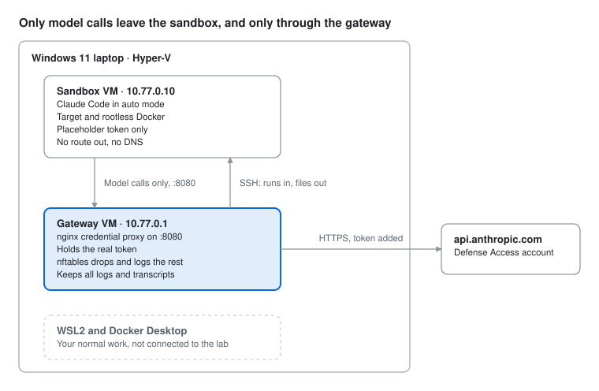

# Design

Two Hyper-V VMs on a private switch. The **sandbox VM** runs Claude Code and the
target, with no route out. The **gateway VM** holds the Claude token, forwards
model calls and nothing else, and keeps every log. This adapts the credential-proxy
pattern in Anthropic's agent containment guidance for Cyber Verification Program
participants to a Windows 11 laptop, which their Linux/KVM reference design
doesn't cover.

The scripts in this repo are the implementation. This page explains why each
control exists and where the build falls short of the guidance.

## Why not WSL2 or Docker Desktop

Anthropic's reference design lists Windows, Docker Desktop and WSL2 as hosts it
won't work on. Plain containers share the host kernel, so a kernel exploit in a
container is a host compromise. WSL2 also mounts the C: drive and can launch
Windows programs by default. Both stay in use for normal work and out of the lab.
Docker still has a job: rootless Docker runs local targets *inside* the sandbox VM.

## How the build meets the guidance

| Property the guidance asks for | How this build does it | Where |
| --- | --- | --- |
| Agent has its own guest kernel | Hyper-V Gen 2 VM | `agentlab.ps1 build` |
| No host directory shared into the guest | No shared folders; Guest Service Interface and KVP off; `hv_sock` blocked from loading | `agentlab.ps1 build`, `sandbox-setup.sh install` |
| Model credential not in the agent's environment or disk | Token lives in a root-only nginx include on the gateway; the sandbox holds a placeholder | `gateway-setup.sh`, `sandbox-setup.sh install` |
| No internet; egress enforced outside the guest | Private switch, no default route or DNS in the sandbox, nftables on the gateway drops and logs everything except `10.77.0.10 → 10.77.0.1:8080`. `agentlab-run` refuses to launch while the sandbox has any route beyond 10.77.0.0/24 in any routing table, any IPv6 address, more than one interface or no 10.77.0.10/24, the tests `agentlab-check` applies. Its preflight runs as the agent, so on a sandbox that wasn't reverted it is a self-report; `agentlab.ps1 run` reverts before every launch | `gateway-setup.sh`, `sandbox-setup.sh cutover`, `agentlab-run` |
| Proxy forwards model calls only | Exact-match allowlist (`POST /v1/messages`, `/v1/messages/count_tokens`); everything else 403; client auth headers stripped | `gateway-setup.sh` |
| No cloud metadata reachable | Not on a cloud host; the gateway refuses to route | `gateway-setup.sh` |
| Turn and time limit on every run | `--max-turns` (headless runs; an interactive run is turn-limited by the operator watching it) and `timeout`, validated before launch; unreadable limits refuse to start, and so do a zero time limit, which `timeout` reads as none, and one over 24 hours. The sandbox's `timeout` runs as the agent, so the gateway bounds the run too, two minutes later | `agentlab-run`, `agentlab.ps1 run` |
| No privileged mode or added capabilities | Agent has no sudo and isn't in `sudo`, `admin`, `wheel`, `docker`, `adm`, `lxd`, `disk`, `root`, `libvirt` or `incus-admin`; `agentlab-check` and the launch preflight both refuse otherwise (the preflight catches password-less sudo, `agentlab-check` any sudo rule). Docker is rootless | `sandbox-setup.sh install`, `agentlab-run` |
| Orchestrator and transcripts on the trusted side | Runs launch from the gateway; transcripts and logs are written there. Agent text the monitor, the scan and the launcher print on the gateway has control characters escaped, and so does the sandbox's stderr on every non-interactive SSH command, so none of it can drive the operator's terminal. The files kept as evidence are byte for byte, so read them with `less` (not `-R`) or `cat -v` | `agentlab-run`, `agentlab-monitor.py`, `agentlab-scan.py` |
| Auto mode as defense in depth, never `bypassPermissions` | Managed settings set `defaultMode: auto` and disable bypass; environment and tampering rules describe the lab; the No-network rule is added only after checks pass | `sandbox-setup.sh install`, `finalize` |
| Setup phase, then attack phase | Tools installed with internet in `install`; `cutover` is permanent; changes go through `reopen` and a re-check | `sandbox-setup.sh` |
| Test the sandbox before relying on it | Config checks, hand checks and a supervised escape test (headless and interactive), repeated after any sandbox, model, firewall or proxy change | `agentlab-check.sh`, `templates/escape-test.md` |
| Keep transcripts and logs 30+ days, review them | 45-day retention; per-run evidence folder; pattern scan over what the gateway saw and over every transcript the sandbox kept; new proxy refusals and firewall denies printed after each run | `gateway-setup.sh`, `agentlab-run`, `agentlab-scan.py` |
| Stop on repeated denials | Monitor ends a run after 3 denials in a row or 20 total, if the run isn't in auto mode or doesn't say which mode it's in, and on input past its size limits. Interactive runs too: a watcher follows the session transcript, and the gateway ends the session when the monitor stops it, the watcher stops reading, or nothing comes from it for 30 seconds | `agentlab-monitor.py`, `agentlab-run` |
| Scope stated as intent in every task | Runs refuse a task file without a `## Scope` section | `agentlab-run`, `templates/task-template.md` |

The firewall logs every protocol, not just refused HTTPS. That closes a gap the
guidance notes in its own design, where plain-HTTP and raw TCP attempts leave no
proxy log line.

## Where this falls short

| Guidance | This build | Mitigation |
| --- | --- | --- |
| Dedicate the host; assume an agent could read anything on it | An everyday laptop, with Hyper-V the only layer between the sandbox and everything else | Keep runs short and watched. For long unattended batches, move this design to a spare Linux machine with KVM |
| Run the escape test on a host you can rebuild | The VM reverts; the laptop doesn't | Watch the test live and stop at the first odd move |
| Sandbox escape classifier score | Not available to agents in Claude Code | Transcript and log review |
| Proxy forwards model calls only | The path allowlist is a starting guess | Tune it from 403 lines after the first real run, in `gateway-setup.sh` so the change is reviewed and survives a rerun |
| Treat auto mode rules as security config | Root-owned managed settings; the agent isn't root | Recheck `claude auto-mode config` after every Claude Code update |
| Orchestrator on the trusted side | An interactive run puts the agent's terminal on yours, escape sequences included, and some terminals act on them (window titles, and in some, clipboard writes); nothing filters a live session | Prefer headless runs for anything long or unwatched, and don't paste into an admin console after an interactive run |
| Stop runs that leave auto mode | The interactive watcher reads transcripts the agent can write, through a process the agent owns, so it's a tripwire that fails closed when it notices (a lost or silent watcher ends the session from the gateway, without waiting on the sandbox), not a control. It follows every transcript written during the session, so a file the agent adds can add lines but not hide any, and as the feed's only writer it sends each record whole. It sends a heartbeat every second, so freezing it ends the session within 30 seconds; the agent can still feed it false lines, heartbeats included. The mode is read from each prompt, so a change mid-turn or in a queued prompt shows at the next recorded one. Subagent transcripts are separate files the watcher doesn't follow | The operator watches an interactive run by definition, and the review scans every transcript the sandbox kept afterward. Every command the gateway runs on the sandbox goes through the agent's own shell, so each has a time bound, the gateway ends the local session itself, and the revert after the run is the backstop |

Whatever the agent sends to the model, including target code and findings, leaves
the network in request bodies the proxy doesn't log.

## Not in v1: work against real networks

Leave this until local runs are clean and routine. Reach to real hosts changes the
risk more than anything else here. When the time comes:

- Allowlist the in-scope targets on the gateway (a forward proxy for HTTP, tightly
  scoped forwarding rules otherwise). Never add the model API host to it.
- Name the targets for auto mode in `environment`, so its containment rules apply
  only outside that range.
- Prefer a staging or replica environment disconnected from production.
- Watch every networked run live, with the ability to stop it at once.
- Add a lab VLAN on the home UniFi network whose firewall permits only the in-scope
  targets, with logging on.
- NOAA targets need ITSO sign-off per engagement, and the approval should cover
  target code and findings going to Anthropic in model requests. Keep autonomous
  agents off live production and safety-critical systems; a person makes every
  state-changing step.

The gateway contains the agent's own traffic, not traffic a networked target sends
on its behalf.

## Decisions worth knowing

- **Token type.** A `claude setup-token` OAuth token for the Pro/Max account with
  Defense Access, forwarded as `Authorization: Bearer`. An API key would need a
  different proxy header.
- **Proxy on a second VM, not localhost.** Anthropic's checklist says "a proxy on
  localhost"; its reference design uses a separate container on the agents'
  network. A separate VM is the closer match on Hyper-V and keeps the token outside
  the sandbox's kernel entirely.
- **Root-owned Claude Code binary.** The installer puts Claude Code in the agent's
  home, where the agent could modify it. `install` copies it to `/usr/local/bin`
  owned by root and removes the agent's copy.
- **`/etc/environment`, not a profile script.** It also applies to commands launched
  over SSH, which is how runs start.
- **SSH drop-in named `00-`.** Ubuntu reads `sshd_config.d` before the main file, the
  first value wins, and the installer's `50-cloud-init.conf` turns passwords on.
- **`client_max_body_size 64m`.** nginx's 1 MB default rejects long agent requests.
- **`net.ipv4.ip_nonlocal_bind`.** Lets nginx bind `10.77.0.1` at boot before the
  address is up.

## Sources

See [sources.md](sources.md).
